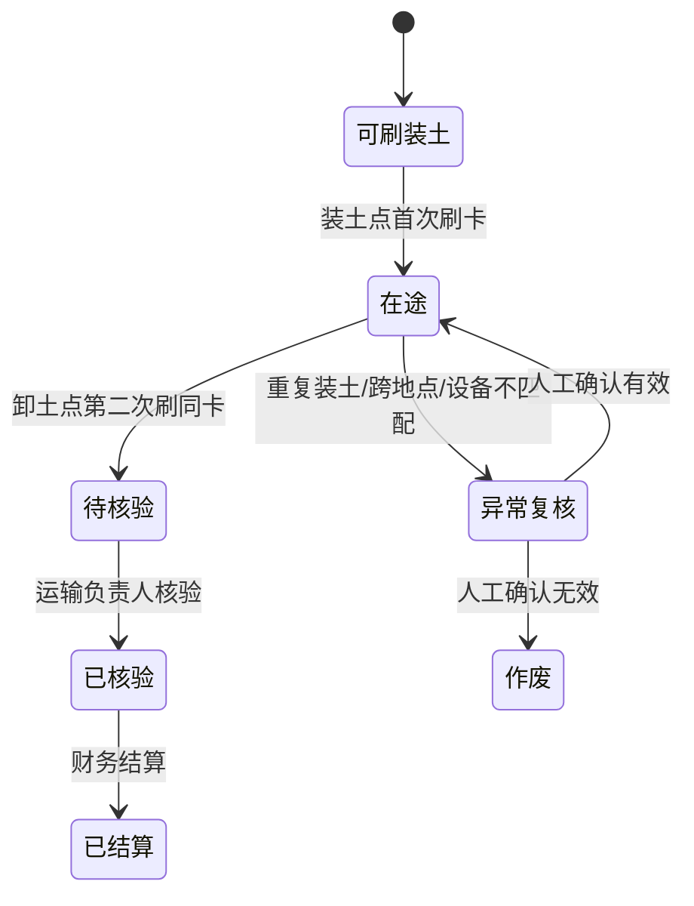

# 运输 NFC 双设备闭环规范

## 一、现场角色与设备边界

装土点与卸土点必须配置为**两个独立的现场设备身份**，每台设备绑定一个已启用的项目地点和一名现场管理员。装土管理员只可在自己绑定的装土点发起车辆卡刷卡；卸土管理员只可在自己绑定的卸土点完成同一趟运输的卸土刷卡。运输负责人和项目负责人保留应急复核权限，但任何跨地点或代刷均须写入异常审计。

| 环节 | 发起人 | 设备与地点 | 系统动作 | 不可绕过的校验 |
|---|---|---|---|---|
| 装土刷卡 | 装土点管理员 | 装土设备 + 装土点 | 读取签名车辆卡，按默认/选定路线创建唯一在途票据，记录“已发车” | 卡有效、车辆可调度、路线有效、设备地点一致、同车无未完成在途票据 |
| 在途 | 司机 | 车辆卡随车 | 系统保存路线、里程、方量、运价快照 | 浏览器不得改写路线、方量、价格或金额 |
| 卸土刷卡 | 卸土点管理员 | 卸土设备 + 卸土点 | 只匹配同车唯一未完成在途票据，记录“已卸土/闭环” | 卡有效、装土已确认、卸土设备地点一致、路线卸土点一致、不得重复卸土 |
| 后续核验 | 运输/财务人员 | 管理后台 | 核验、结算、导出与审计 | 已结算票据不得回退或重复结算 |

## 二、票据状态机

系统以服务端运输趟次为唯一业务单据。卡片不是计价账本，只是带签名的车辆身份和受控深链凭证。装土刷卡成功后，系统创建或锁定一笔状态为“在途”的 NFC 票据；卸土刷卡成功后，系统只闭合同一票据，进入“待核验”。

## 三、重复与异常处理

同一车辆在同一项目中只允许存在一笔 NFC 在途票据。装土设备重传使用事件幂等键返回原结果，不创建第二笔票据；使用新幂等键重复刷卡会进入异常复核。卸土点只可关闭该车辆当前唯一在途票据；没有在途票据、已卸土、跨项目、卡未绑定、地点不匹配和设备不匹配均不改变票据财务状态。

每次刷卡记录项目、票据、车辆、地点、管理员、设备编号、UID 指纹、发生时间、事件摘要和校验结果。原始 UID、完整司机电话、卡片签名原文均不进入普通审计列表。

## 四、NFC 手机直达页面

正式车辆卡写入 NDEF URL 时，URL 只包含卡绑定引用、项目、载荷修订号和服务端签名令牌。手机触碰后仅打开系统的运输票据页面，不包含车辆价格、路线、方量、司机电话或结算信息。页面加载后由服务端重新校验卡签名、卡状态、车辆状态、项目范围和当前操作者权限；通过后才显示“装土发车”或“卸土确认”。

## 五、通知边界

装土成功后，系统向项目运输管理范围和已绑定服务号的司机登记“已发车”通知；卸土成功后登记“运输闭环待核验”通知。通知是异步审计通道，失败不会回滚装土或卸土业务事件。实际微信下发仍依赖新服务号审核通过的合规模板、模块绑定和用户关注/绑定状态。
